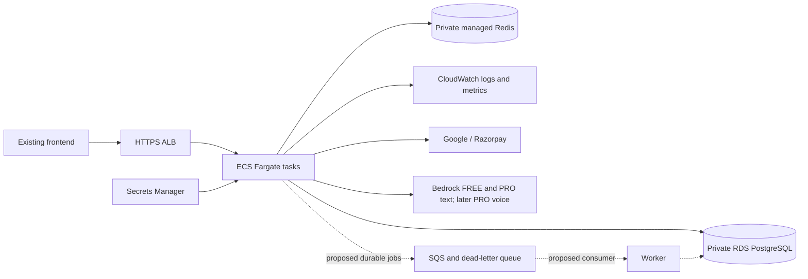

# AWS migration plan

Status: **future production proposal, not the selected demo deployment**. Revised 2026-10-21: the user chose a warm, low-cost demonstration in Mumbai, Netlify frontend, and no purchased domain or separate load balancer. Step 15 now prepares [App Runner demo infrastructure and release workflow](handoffs/STEP-15.md), keeping the ECS/Fargate/RDS/ElastiCache design below for a later production decision. No AWS resources have been provisioned or live databases inspected.

## 1. Recommended approach

Move the existing Java container and PostgreSQL schema first, after addressing the reference's release-blocking findings. Keep the authentication model and Razorpay integration initially. Implement Bedrock-only AI routing as a separately tested change before the target production release; separate provider, framework, and infrastructure changes so failures remain attributable and rollback remains practical.

Use **Amazon ECS on AWS Fargate**, an Application Load Balancer, RDS PostgreSQL, managed Redis, Secrets Manager, and CloudWatch. Fargate runs containers without requiring the team to provision or manage EC2 servers. Configure container CPU/memory, networking, IAM, health checks, and scaling. Use the Fargate launch type/capacity provider explicitly. [AWS Fargate documentation](https://docs.aws.amazon.com/AmazonECS/latest/developerguide/AWS_Fargate.html).

Publish tested images to Docker Hub. Direct authenticated pulls are supported; an ECR mirror remains an optional reliability improvement. Keep one backend ECS service initially, with a separate worker service only when durable jobs justify it. Estimate Fargate task resources/runtime, ALB, database, Redis, NAT/egress, secrets, logs, and backups before selecting capacity. Region, budget, traffic, and recovery targets remain open decisions.

The queue/worker is a proposed application change, not something infrastructure can add transparently to the existing event listener.

## 2. Component mapping and prerequisites

| Existing component | Proposed AWS destination | Required work |
| --- | --- | --- |
| Java Docker image | Docker Hub + ECS Fargate service; optional ECR mirror | CI tests, immutable digest, task CPU/memory, health checks, rollout and graceful shutdown |
| Port 8080 with `/api/v1` | HTTPS ALB target group | Preserve path prefix, configure certificate/DNS, readiness target, timeout/draining behavior |
| PostgreSQL | Private RDS PostgreSQL | Select compatible version; restore rehearsal; Flyway validation; TLS and backups |
| Redis denylist/rate limits | Private ElastiCache deployment with compatible Redis protocol | Validate topology, TLS/auth, eviction and failover; current config assumes a single host/port |
| Environment secrets | Secrets Manager references in ECS task definitions | Execution-role access, preserved encryption/signing keys, replacement tasks after rotation |
| stdout | CloudWatch | Remove tokens first; log retention and access control; structured request/job identifiers |
| In-process summary event | Durable outbox + queue/worker, or durable DB job polling | After-commit semantics, duplicate handling, retries, dead-letter/recovery path |
| Midnight expiry job | One coordinated scheduler or external scheduled invocation | Avoid accidental per-replica scheduling; explicitly choose timezone |
| Render keep-alive workflow | Retire after successful cutover | It is not monitoring and should no longer ping the old deployment |

Use infrastructure-as-code for new resources; Terraform is a proposed default, not existing tooling. Separate environments and IAM roles. The **task execution role** handles registry pulls, log delivery, and task-definition secret injection. The **task role** grants the application scoped Bedrock/SQS access and any direct Secrets Manager API access. The **CI deployment role** registers task revisions and updates approved services, with `iam:PassRole` limited to designated task/execution roles. Do not put long-lived AWS keys in containers. [AWS execution-role documentation](https://docs.aws.amazon.com/AmazonECS/latest/developerguide/task_execution_IAM_role.html).

Place Fargate tasks and data services in private subnets, with the ALB as public ingress. Use `awsvpc` networking and an ALB target group with target type `ip`. Restrict task ingress to the ALB security group and database/Redis ingress to the application/worker security groups. Plan outbound connectivity for Docker Hub, OAuth, and Razorpay, plus image/secret/log access to AWS services. Private subnets require an explicit NAT/endpoints design; endpoints alone do not provide access to external providers.

### Docker Hub and ECS Fargate release pipeline

1. Pull requests: run `./mvnw verify`, real PostgreSQL/Redis tests, dependency/container scanning, Docker build, and infrastructure/task-definition validation. Do not expose deployment or registry-write credentials to untrusted PR code.
2. Trusted tag/release: require the exact-commit CI image scan, then build once for publishing, attach source revision and SBOM/provenance, push a commit tag, scan the published digest, and record the immutable Docker Hub digest only after the release gate passes. A controlled image tag may publish from the tested backend branch tip before the application changes merge into `main`; this does not deploy the image. Store a least-privileged Docker Hub token in a protected CI environment. Docker Hub personal access token repository permissions apply to all repositories the account can access; organization access tokens can be repository-scoped. Pin third-party actions to reviewed commit SHAs.
3. Optionally copy the same artifact to ECR and record/verify the destination manifest digest and platform. Do not rebuild for production or assume a registry copy preserves every manifest representation.
4. GitHub Actions uses OIDC to assume the limited AWS deployment role; restrict trust to the repository and allowed branch/environment. Docker Hub authentication is separate. [GitHub AWS OIDC documentation](https://docs.github.com/en/actions/how-tos/secure-your-work/security-harden-deployments/oidc-in-aws).
5. Run one controlled Flyway migration as a one-off Fargate task in the private network, with dedicated DDL credentials where practical. Use the Step 14 `migrate` entrypoint rather than the server process. Wait for task completion and check its container exit code, not just successful task launch. Disable application-startup Flyway after this mechanism is tested; migrations must remain compatible with the previous service revision.
6. Register a Fargate-compatible task-definition revision referencing the exact image digest and update the staging ECS service. Wait for service stability and healthy ALB targets; run API, OAuth, SSE, provider-routing, and payment smoke tests with synthetic accounts. Promote the same tested artifact to production. Serialize deployments per environment and explicitly assign ownership of image/task revisions between Terraform and CI to avoid drift.
7. Enable deployment failure detection/rollback for the chosen ECS deployment strategy and configure alarms. Restore the previous task-definition/config revision on application failure. Service rollback does not roll back the database; follow section 5.

For authenticated Docker Hub pulls, store a read-only registry credential in Secrets Manager and reference it via container `repositoryCredentials`; grant the task execution role access. This is separate from the CI push credential. Test fresh-task startup, credential rotation, and scaling under pull limits. [AWS external registry authentication](https://docs.aws.amazon.com/AmazonECS/latest/developerguide/private-auth.html), [Docker Hub limits](https://docs.docker.com/docker-hub/usage/pulls/).

Initial infrastructure: ECS cluster/service, Fargate task definitions, ALB/listener/IP target group, security groups/subnets, IAM roles, secret references, CloudWatch logs/alarms, and ECS Service Auto Scaling. Define valid Fargate CPU/memory combinations and container health checks, ALB readiness path, startup grace, deployment minimum/maximum healthy percentages, and desired/min/max task counts. For availability across failures, use enough tasks across Availability Zones for the chosen target. CPU alone misses long-lived streams; add active-stream/load measurements as needed. Bound scaling by database connections, provider quotas, Fargate quotas, and spend.

Coordinate application graceful shutdown, Fargate stop timeout, ALB target draining, and stream deadlines. Prefer regular Fargate capacity for interactive chat; consider Fargate Spot only for interruptible, retryable background work. Keep PostgreSQL/Redis managed and invoke Bedrock through its API. Maintain application/base-image patches and test task replacements, but no EC2 node configuration, Kubernetes manifests, or Helm releases are part of this plan.

## 3. Application changes required for migration

### HTTP and streaming

- Use `/api/v1/actuator/health/liveness` for dependency-free liveness and `/api/v1/actuator/health/readiness` for PostgreSQL/Redis readiness. Health access is unauthenticated but component details are hidden. Do not make Bedrock availability a liveness dependency; avoid restarting every task during a short provider outage. Validate these paths through the ALB before using them as target health checks.
- Preserve `/api/v1` through routing and update the frontend `VITE_API_BASE_URL` to include it. Test the separate fetch-based SSE path as well as Axios paths.
- Configure trusted forwarded headers so OAuth produces the external HTTPS callback host. Register `https://<backend-host>/api/v1/login/oauth2/code/google` with Google; test cross-instance OAuth authorization state.
- Set exact CORS origins, with the desired OAuth frontend first until that coupling is removed.
- Reconcile the application emitter's 60-second total timeout with provider deadlines, load-balancer idle timeout, and graceful shutdown. ALB's default idle timeout is 60 seconds; this measures inactivity, not total stream duration. Add heartbeat/cancellation behavior deliberately and test a slow first token plus a long active stream. [AWS ALB timeout documentation](https://docs.aws.amazon.com/elasticloadbalancing/latest/application/edit-load-balancer-attributes.html).
- Drain existing streams during deployments and test interruption behavior. Current SSE has no resume mechanism, so a task replacement may leave a saved user message without a completed assistant response.

### Data, secrets, and identity

- Preserve the exact existing `ENCRYPTION_MASTER_KEY` for restored encrypted rows. Test decryption through the application with a synthetic fixture; do not place real therapy content in build logs or AI prompts.
- Preserve JWT signing keys if existing access tokens should survive cutover. Their format is base64 DER, not PEM text. Planned key rotation requires a separate compatibility/session invalidation strategy.
- Treat Redis revocation entries as security state. Empty Redis can make logged-out JWTs valid again until expiry. Either transfer remaining denylist entries/TTLs, keep using the old Redis during transition, or deliberately invalidate outstanding access tokens and coordinate reauthentication. Rate counters can reset only as an explicit decision.
- Configure database TLS with hostname/certificate verification and provision the required trust material. RDS PostgreSQL supports TLS; verify the chosen driver configuration against the target environment. [AWS RDS PostgreSQL TLS documentation](https://docs.aws.amazon.com/AmazonRDS/latest/UserGuide/PostgreSQL.Concepts.General.Security.html).
- Use task-definition `secrets` entries to inject Secrets Manager values into the environment expected by the current Spring application. Updating a secret does not refresh running task environment variables or Java key objects; deploy replacement tasks deliberately. Preserve encryption-key compatibility throughout rotation. [AWS ECS secret injection](https://docs.aws.amazon.com/AmazonECS/latest/developerguide/secrets-envvar-secrets-manager.html).
- Decide payment-record retention, account deletion, backups, and external AI retention with the product owner. Moving hosting does not change what decrypted content is sent to the AI provider.

### Transactions, jobs, and scaling

Before running multiple replicas, make session completion idempotent and add durable summary processing. An outbox row written in the same transaction as session completion avoids losing work between committing the conversation and publishing a queue message. Consumers should accept IDs, reload current data, claim jobs safely, tolerate duplicate delivery, record attempts, and ignore users/conversations deleted before execution. Track explicit pending/running/succeeded/failed states; do not use `summarized_at` to hide failed extraction.

An after-commit listener alone fixes a race but still loses work during process failure. A queue alone does not solve the database-to-queue atomicity problem. A simpler alternative is a database-backed job table with safe claims and retries; choose based on workload rather than adding a queue automatically.

Bound thread pools, set provider deadlines, and move external calls outside long database transactions where possible. Size DB pools using total replicas × per-task pool size, plus workers/migration/admin headroom. The current maximum is 10 connections per application task. Test simultaneous messages/session creation, refresh rotation, duplicate payment callbacks, and account deletion while a summary is pending.

## 4. Migration phases and exit criteria

Follow [DEVELOPMENT_PLAN](DEVELOPMENT_PLAN.md) for application execution order. Staging infrastructure and recovery rehearsals precede frontend implementation. Production data/traffic cutover waits until the final frontend integration and browser acceptance gates pass; these infrastructure phases do not override that release dependency.

### Phase A — inventory and baseline

Record live application/image revision, environment variable names and secret locations (not values), PostgreSQL version/size/extensions, migration history, Redis topology, DNS, OAuth callbacks, Razorpay webhook configuration, traffic/concurrent streams, and existing backups. Agree on recovery point/time objectives and an acceptable write-pause window. Confirm backup/key access and restore ownership.

Run the existing tests and establish a real PostgreSQL/Redis integration suite. Add contract tests for authentication, authorization, encrypted persistence, SSE completion/failure, payment verification/webhooks, and deletion. Exit: reproducible baseline and a tested restore of synthetic/encrypted fixtures, with known issues recorded.

### Phase B — production prerequisites

Fix P0 findings, authorization matcher, safe logging, health checks, config validation, timeouts, and reliable jobs. Resolve payment ownership/currency validation and disable production development routes. Add deployment tests for OAuth and Redis outage behavior. Exit: acceptance checks pass; production flags cannot grant free PRO access or accept unsigned webhooks.

### Phase C — staging infrastructure and rehearsal

Provision infrastructure from reviewed code. Build/test/publish an immutable image and deploy to staging. Rehearse a database restore with the same encryption key arrangement in an appropriately restricted environment. Do not mix a restored schema with blind baseline commands or changed migration checksums. Validate Flyway history and Hibernate startup.

Use the controlled one-off migration task before rolling the application service. The current application runs Flyway at startup; disable it on service tasks only after introducing and validating the dedicated migrator. Use additive, backward-compatible migrations during rolling releases.

Exit: staging passes the acceptance matrix below, backup restore works, and the infrastructure cost estimate is accepted by the project owner.

### Phase D — data cutover

For a small database with an acceptable maintenance window, start with a rehearsed logical dump/restore. PostgreSQL `pg_dump`/restore is a documented RDS import route; adapt roles, ownership, privileges, and extensions to the actual source and target. [AWS PostgreSQL import documentation](https://docs.aws.amazon.com/AmazonRDS/latest/UserGuide/PostgreSQL.Procedural.Importing.EC2.html).

1. Take a verified backup; record image/config/migration revisions and key references.
2. Pause writes at the application boundary. Drain streams and background work; keep payment webhook deliveries durably accounted for or deliberately return a retryable failure until processing resumes.
3. Perform final export/restore (or finish a separately rehearsed replication cutover if downtime targets require it). Preserve UUIDs, timestamps, encrypted strings, and `flyway_schema_history`.
4. Validate row counts, constraints, critical relationships, subscriptions, migration history, and application decryption. Compare representative records securely rather than printing their contents.
5. Apply the Redis/JWT transition decision. Confirm only the intended deployment can process writes/jobs/webhooks.
6. Switch API routing/DNS and external callbacks; smoke-test before reopening normal traffic. Monitor errors, payment delivery, and summary backlog.

Do not let old and new deployments write independently to divergent databases. If low downtime is mandatory, design a replication plan with explicit lag, final-sync, and writer-switch gates rather than assuming a one-time dump is sufficient.

### Phase E — observe and retire

Keep the previous application image/config and rollback resources for the agreed observation period. Monitor auth failures, stream completion/latency, provider errors, DB pool saturation, Redis availability, failed summaries, and webhook failures. Confirm alarms and restore drills. Retire the Render keep-alive and old resources only after the migration is accepted and data retention requirements are met.

## 5. Rollback rules

Before cutover, define objective abort thresholds and who makes the decision. Example triggers include decryption failures, lost writes, duplicate entitlements, persistent login failures, and unacceptable stream error rates; choose numerical thresholds from the baseline.

- Before the target accepts writes: restore routing to the old deployment, keep the target isolated, and retry after diagnosing the failure.
- After the target accepts writes: do not point users at a stale source database. Prefer rolling back application code against the current database when compatible. Otherwise pause writes and reconcile/copy new data using a rehearsed reverse migration before switching.
- Schema rollback is separate from image rollback. Use expand/contract changes and postpone destructive migrations until the old version is no longer a rollback candidate.
- Preserve encryption keys, signing keys, webhook delivery history, and job state throughout rollback. A successful container rollback alone does not establish data integrity.

## 6. Acceptance matrix

| Area | Evidence required before production cutover |
| --- | --- |
| Authentication | Register/login/refresh/logout; revoked JWT rejected; Google redirect works through ALB and across replicas |
| Authorization | Anonymous account deletion rejected; cross-user chat/memory access rejected; dev routes unavailable |
| Database | Flyway/ORM validation; restored encrypted fixtures readable; no schema drift; backup restore tested |
| Chat | Both tiers use Bedrock for greeting/chat/extraction; no external AI fallback; subsidy/spend gates, throttling/timeout, streaming/disconnect, task draining, concurrent operations |
| Jobs | Committed sessions processed; duplicates safe; crash/retry/restart recover; deletion cannot resurrect data |
| Payments | Valid signed capture; invalid signatures rejected; ownership/currency checks; duplicate/out-of-order delivery safe |
| Redis | TLS/auth and outage behavior tested; revocation continuity and counter expiry verified |
| Operations | Healthy/unhealthy targets route correctly; private data services; safe logs; alerts; rollback rehearsal |

## 7. Decisions still needed

Record decisions before implementing infrastructure: AWS account/region, monthly budget, availability and recovery targets, concurrent streams, live data volume/versions, downtime window, frontend hosting/domain, secret ownership, payment reconciliation procedure, and whether the first release requires multiple replicas. These are not assumptions an AI assistant should silently convert into deployed infrastructure.

Also decide Docker Hub organization/repository visibility, direct pulls versus ECR mirror, ECS environment separation, Fargate CPU/memory and service scaling, and outbound networking. Do not infer that a free customer plan means infrastructure can run at zero cost. See [future architecture](FUTURE_ARCHITECTURE.md) for model routing, tier quotas, Cognito evaluation, framework upgrades, and voice milestones.
