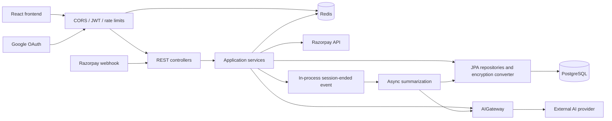

# Backend reference

Reviewed: 2026-10-19. Scope: backend source, SQL migrations, build/container configuration, existing tests, and selected frontend API callers. This is a static source review; no production access, startup, or test execution was performed. Existing local edits were preserved. All paths below are relative to this document unless stated otherwise.

For the proposed Docker Hub/ECS Fargate, Bedrock-only tier/model routing, rate limits, Cognito evaluation, Spring upgrades, and future voice, see [future architecture](FUTURE_ARCHITECTURE.md). None of those proposals changes the current behavior documented here.

The approved storage direction remains PostgreSQL; [memory design](MEMORY_DESIGN.md) specifies future confirmation, retrieval, provenance, and forget/reset behavior. Those features are not yet implemented; this document preserves the current-state snapshot.

For a focused comparison of the current schema with frontend/API behavior, see [schema review](SCHEMA_REVIEW.md), including onboarding payload mismatches and persona/completion semantics.

## 1. Architecture and boundaries

The backend is one Spring MVC application, not a set of microservices. It uses PostgreSQL for durable data and Redis for access-token revocation and chat rate limits. AI responses use an OpenAI-compatible HTTP API (Groq by default). Google OAuth and Razorpay are separate external integrations.



There is no durable queue, vector database, file-upload storage, AWS SDK integration, infrastructure-as-code, or Actuator dependency in the reviewed backend. Redis is not currently a conversation or prompt cache.

| Area | Source | Responsibility |
| --- | --- | --- |
| Startup | [AiTherapyApplication](../src/main/java/com/hkv/AiTherapy/AiTherapyApplication.java) | Enables Spring Boot, scheduling, and async execution |
| HTTP | [controller](../src/main/java/com/hkv/AiTherapy/controller) | Auth, chat, profile/memory, payment, and development routes |
| Security | [SecurityConfig](../src/main/java/com/hkv/AiTherapy/config/SecurityConfig.java), [security](../src/main/java/com/hkv/AiTherapy/security) | JWT, Google OAuth, authorization, Redis rate limits |
| Application logic | [service](../src/main/java/com/hkv/AiTherapy/service) | Auth/token lifecycle, chat, profiles, memories, payments, deletion |
| AI integration | [service/ai](../src/main/java/com/hkv/AiTherapy/service/ai) | Gateway interface, HTTP implementation, prompt assembly |
| Background work | [service/job](../src/main/java/com/hkv/AiTherapy/service/job) | Summarization event listener and subscription expiry scheduler |
| Persistence | [domain](../src/main/java/com/hkv/AiTherapy/domain), [repository](../src/main/java/com/hkv/AiTherapy/repository) | Nine JPA entities/repositories, UUID identifiers |
| Encryption | [encryption](../src/main/java/com/hkv/AiTherapy/encryption) | Explicit JPA field conversion using AES-256-GCM |
| Contracts | [dto](../src/main/java/com/hkv/AiTherapy/dto) | HTTP request/response objects and AI payloads |
| Schema/config | [resources](../src/main/resources) | Flyway migrations V1–V4 and application configuration |
| Packaging | [pom.xml](../pom.xml), [Dockerfile](../Dockerfile) | Java 21, Boot 3.4.4, JJWT 0.12.5; Maven build and non-root JRE container |

## 2. Runtime flows

### Authentication

`AuthController → AuthService → UserRepository / TokenService / JwtTokenProvider`.

- Registration stores a BCrypt password hash and immediately issues tokens. Email verification is not implemented despite the `is_verified` field.
- Login checks the password and active flag. Access tokens are RS256 JWTs with user UUID subject, email, JTI, and expiry; default validity is 900 seconds.
- Refresh tokens are two UUID strings combined. PostgreSQL stores their SHA-256 hashes, device information, expiry, and revocation flag. Refresh revokes the old record and issues a new token pair; default refresh validity is 30 days.
- JWT authentication checks Redis key `jwt:denylist:<jti>` and creates a UUID-string principal with `ROLE_USER`. It does not load the user or recheck active status on every request.
- Logout revokes the supplied refresh token and denylists a supplied valid access token for the full configured access-token lifetime.
- Google login finds a user by provider/subject, then email, or creates one. It redirects to the first CORS origin at `/oauth2/redirect?token=...`, optionally adding `new_user=true`. It issues no refresh token and currently prints the access token to stdout.
- The filter chain declares stateless sessions, but the OAuth authorization-request state repository is not explicitly configured. Verify the redirect round trip across instances before scaling.

### Chat and prompts

`ChatController → ChatService → PromptBuilder / AIGateway / repositories`.

1. Starting a session finds the latest active session, reads its last six messages, and ends it. A new conversation is created and the AI generates a greeting using the previous transcript when available.
2. Sending a normal message checks ownership and active status, stores the user message, retrieves six recent messages in chronological order, prepends a system prompt, calls the provider, and saves the reply. This method holds a database transaction during the network request.
3. Streaming checks ownership and rejects `completed` conversations, saves the user message, then returns a 60-second `SseEmitter`. Text chunks are unnamed SSE data events. Completion persists the assistant message and updates the count. There is no explicit terminal event, event ID, reconnect cursor, or cancellation wiring to the provider.
4. Ending a session marks it completed, increments profile session count if a profile exists, and publishes `SessionEndedEvent`. Repeating this operation can increment the count again.

[PromptBuilder](../src/main/java/com/hkv/AiTherapy/service/ai/PromptBuilder.java) uses the profile name, age, persona, style, topics, top five traits, and five most important unresolved memories. Missing profiles get a short fallback prompt. Due-follow-up and last-completed-session repository methods exist but are not used by this builder. There is no enforced prompt token budget.

[OpenAICompatibleGateway](../src/main/java/com/hkv/AiTherapy/service/ai/OpenAICompatibleGateway.java) posts to `<base-url>/chat/completions`. Active PRO status selects the PRO endpoint/key/model for greetings and chat. Summarization always uses the default provider/model. Chat requests hardcode temperature 0.7 and max tokens 1500; summaries use 0.2 and 2000. Non-streamed requests have a 60-second request timeout, up to three attempts, and backoff for HTTP 429. Streaming has no request timeout or retry policy; provider 429 is emitted as `[ERROR: RATE_LIMIT_EXCEEDED]` and can be saved as assistant content. Token counts are estimates, not provider billing measurements.

### Summarization and scheduled work

[SummarizationJob](../src/main/java/com/hkv/AiTherapy/service/job/SummarizationJob.java) is an `@Async @EventListener`, not a polling scheduler. It loads the full transcript, asks the default AI for JSON, updates the summary/profile/traits/memories, and sets `summarized_at`. Mid-session refresh runs extraction synchronously, updating traits and profile without saving memories or marking the session summarized.

Trait keys and memory titles are compared in Java after loading existing records. This is not concurrency-safe deduplication. Extracted memories do not currently populate `source_conv_id`. Extraction applies name and age updates, not gender. Failures can be silently swallowed; parsing/persistence failure can still mark a conversation summarized. The event is published inside a transaction and is not an after-commit event, so a listener can race the commit. There is no durable retry or recovery scan even though `findUnsummarized()` exists.

[SubscriptionDowngradeJob](../src/main/java/com/hkv/AiTherapy/service/job/SubscriptionDowngradeJob.java) runs at midnight in the scheduler's timezone (no explicit zone). Every application instance would run it. Effective PRO entitlement separately checks `tier == PRO` and a future expiry, so expired access does not depend on the job running.

### Payments and deletion

[SubscriptionService](../src/main/java/com/hkv/AiTherapy/service/payment/SubscriptionService.java) fetches a payment from Razorpay for manual verification, requires captured status and at least 5000 paise, records it, and sets PRO expiry to now + 30 days. This resets expiry rather than extending an existing remaining period. There is no recurring billing or refund processing.

Webhooks require HMAC-SHA256 even in development mode; a missing secret returns 503 and an invalid signature returns 400. Only `payment.captured` triggers an upgrade. The user comes from `notes.userId`; missing user notes return 200 without recording an upgrade. Payment IDs are unique and checked before processing, but concurrent duplicate delivery still needs tested conflict handling. Currency and manual-payment ownership are not validated.

[AccountService](../src/main/java/com/hkv/AiTherapy/service/account/AccountService.java) deletes messages, memories, traits, profile, conversations, refresh tokens, then user; SQL cascades also remove subscriptions/payments. It removes the rate-limit key, but does not invalidate all outstanding access JWTs. Database deletion does not erase historical backups or provider-held data. Profile deletion removes profile, traits, and memories, leaving conversations and account intact; later summarization can recreate derived information.

## 3. HTTP contract

Default server: `http://localhost:8080/api/v1`. Paths below are relative to `/api/v1`. Authenticated requests use `Authorization: Bearer <access-token>`. UUID ownership is checked in chat/memory services.

Most successful responses use `{success, data, error, timestamp}` from [ApiResponse](../src/main/java/com/hkv/AiTherapy/dto/response/ApiResponse.java). Error formatting is inconsistent: there is no global exception handler; filters, validation, and uncaught service exceptions can return different shapes/statuses. Do not promise a uniform error contract without integration tests.

| Method/path | Input | Success result / access |
| --- | --- | --- |
| POST `/auth/register` | `email`, `password` (min 8), optional `displayName` | 201, AuthResponse; public |
| POST `/auth/login` | `email`, `password` | 200, AuthResponse; public |
| POST `/auth/refresh` | `refreshToken` | 200, rotated AuthResponse; public |
| POST `/auth/logout` | `refreshToken`, optional bearer header | 200, message; public matcher |
| DELETE `/auth/account` | No body | 200, string; JWT required |
| POST `/chat/sessions` | No body | 201, ConversationResponse with greeting; JWT |
| POST `/chat/sessions/{id}/messages` | Nonblank `content` | 200, ChatMessageResponse; JWT |
| POST `/chat/sessions/{id}/stream` | Nonblank `content` | `text/event-stream`; JWT |
| PUT `/chat/sessions/{id}/end` | No body | 200, null data; JWT |
| POST `/chat/sessions/{id}/refresh-profile` | No body | 200, null data after extraction; JWT |
| GET `/profile/me` | No body | 200, ProfileResponse; JWT; attempts lazy profile creation |
| PUT `/profile/me` | Optional `preferredName`, `ageRange`, `communicationStyle`, `aiPersona`, `topicsOfConcern` | 200, ProfileResponse; JWT |
| DELETE `/profile/me` | No body | 200, string; JWT |
| GET `/profile/me/memories` | `type`, `resolved`, `offset=0`, `limit=20` | 200, MemoryPageResponse; JWT |
| POST `/profile/me/memories` | `type`, `title`, optional `detail`, `importance` (1–10, default 5), `occurredAt`, `followUpAt` | 200, MemoryResponse; JWT |
| DELETE `/profile/me/memories/{id}` | No body | 204, no envelope; JWT |
| GET `/payment/status` | No body | 200, SubscriptionStatusResponse; JWT |
| POST `/payment/verify` | Nonblank `paymentId` | 200, SubscriptionStatusResponse; JWT, not dev-gated |
| POST `/payment/webhook` | Raw JSON, `X-Razorpay-Signature` | Plain text `ok`; public with HMAC check |
| POST `/dev/force-pro` | No body | 200, SubscriptionStatusResponse; JWT and `DEV_MODE=true` required |
| POST `/dev/force-free` | No body | 200, SubscriptionStatusResponse; JWT and `DEV_MODE=true` required |

Google OAuth uses framework paths `/oauth2/authorization/google` and `/login/oauth2/code/google` under the context path. Check these with the deployed external host/proxy configuration.

Contract details for future changes:

- AuthResponse: `accessToken`, `refreshToken`, `expiresIn`, `user: {id,email}`.
- ConversationResponse: `id`, `status`, `tokenCount`, `startedAt`, `recentMessages`.
- ChatMessageResponse: `id`, `conversationId`, `senderRole`, `content`, `sentAt`.
- ProfileResponse: `userId`, the five editable profile fields above, `totalSessions`, `traits: [{key,confidence,source}]`.
- MemoryPageResponse: `memories`, `total`, `offset`, `limit`; MemoryResponse includes `id`, `type`, `title`, `detail`, `importance`, dates, and a boolean resolved property. Verify Jackson's actual boolean naming in contract tests before changing it.
- SubscriptionStatusResponse explicitly serializes `isPro`, alongside `tier` and `proExpiresAt`.
- There is no controller API for listing historical sessions, editing/resolving a memory, or managing traits directly.
- Profile updates ignore null fields; they do not implement clearing fields via null. V2 onboarding fields are not in the DTO/entity flow.
- Memory pagination computes `page = offset / limit`, so arbitrary offsets are rounded down to page boundaries; zero/negative/unbounded inputs are not guarded.
- Frontend [client.js](../../Frontend/src/api/client.js) already unwraps successful envelopes. [chat.js](../../Frontend/src/api/chat.js) has a double-unwrapping mismatch in `sendMessage`, and its fallback streaming URL omits `/api/v1`. Preserve/check all callers when revising the contract.

## 4. Persistent data and encryption

Source of schema truth: [Flyway migrations](../src/main/resources/db/migration). V1 creates the original seven tables; V2 adds onboarding columns; V3 widens age range to 50; V4 adds subscriptions/payments. Hibernate uses `ddl-auto: validate`. Add new migrations rather than rewriting applied migration files.

| Table | Relationships and purpose | Application-encrypted columns |
| --- | --- | --- |
| `users` | Identity; unique email; OAuth fields; BCrypt hash; status flags | None |
| `therapy_profiles` | Unique user FK; preferences and session count | `preferred_name`, `topics_of_concern` |
| `personality_traits` | User FK; unique `(user_id,trait_key)` | `trait_value` |
| `conversations` | User FK; status, summary, timing, token estimate | `session_summary` |
| `messages` | Conversation FK; role, text, timestamp | `content` |
| `long_term_memories` | User FK; optional source conversation FK, ranking/dates | `title`, `detail` |
| `refresh_tokens` | User FK; unique SHA-256 token hash, expiry/revocation | None (token is hashed) |
| `user_subscriptions` | Unique user FK; FREE/PRO and expiry | None |
| `payments` | User FK; unique Razorpay payment ID; amount/currency/status | None |

User-dependent FKs cascade on user deletion; messages cascade on conversation deletion; memory source FK uses `ON DELETE SET NULL`. Important indexes support user/conversation history, trait confidence, memory importance, and PRO expiry. No database constraint enforces a single active session per user.

Encryption is `Base64(12-byte IV || ciphertext || 16-byte GCM tag)` using one configured 32-byte key. The converter is opt-in, so identity metadata, trait keys, age, and payment records are not application-encrypted. V2's `enjoyments` SQL comment says encrypted, but no mapped entity/converter currently implements it. The memory title is declared TEXT in the entity while V1 creates `VARCHAR(500)`; encoded ciphertext expansion can exceed that database limit.

**Preserve the existing encryption master key when moving an existing database.** A newly generated key cannot decrypt old records. There is no key ID/version or rotation mechanism in the ciphertext format. RDS disk encryption or storing the key in Secrets Manager does not replace this application encryption. Prompt assembly decrypts data before sending it to the external AI provider.

## 5. Configuration and local operation

Source: [application.yaml](../src/main/resources/application.yaml). Spring receives environment variables; use [run-with-env.sh](../run-with-env.sh) for local `.env` loading and [compose.yaml](../compose.yaml) for disposable PostgreSQL/Redis services.

| Environment variables | Current meaning/default |
| --- | --- |
| `DATABASE_URL` | JDBC URL; default `jdbc:postgresql://localhost:5432/therapyai` (not a `postgres://` URL) |
| `DATABASE_USER`, `DATABASE_PASSWORD` | Default local user/password; replace for deployed environments |
| `REDIS_HOST`, `REDIS_PORT`, `REDIS_PASSWORD`, `REDIS_SSL` | localhost, 6379, empty password, false; timeout 2 seconds |
| `JWT_PRIVATE_KEY`, `JWT_PUBLIC_KEY` | Required for startup: base64 DER PKCS#8 private key and X.509 public key; parser strips whitespace, not PEM headers |
| `ENCRYPTION_MASTER_KEY` | Required for startup: base64 encoding of exactly 32 bytes |
| `GOOGLE_CLIENT_ID`, `GOOGLE_CLIENT_SECRET` | Dummy defaults; real credentials needed for OAuth |
| `AI_BASE_URL`, `AI_API_KEY`, `AI_MODEL` | Default URL `https://api.groq.com/openai/v1`, empty key, model `llama-3.1-8b-instant`; model availability not verified |
| `AI_PRO_BASE_URL`, `AI_PRO_API_KEY`, `AI_PRO_MODEL` | Fall back individually to default provider settings |
| `CORS_ALLOWED_ORIGINS` | Comma-separated exact origins, default `http://localhost:5173`; first also determines OAuth frontend redirect |
| `RAZORPAY_KEY_ID`, `RAZORPAY_KEY_SECRET` | Used by manual payment fetch; empty defaults |
| `RAZORPAY_WEBHOOK_SECRET` | Required for signed webhook processing in every mode |
| `DEV_MODE` | Defaults false; `/dev/*` controllers are absent unless explicitly true |

Hikari allows 10 connections per instance (minimum idle 2). Redis contains `jwt:denylist:*` with a 900-second default TTL and `rl:chat:<userId>` with a one-minute TTL. The chat filter hardcodes 20 authenticated POST requests per minute across session creation, messaging/streaming, and profile refresh. Increment and expiry are separate operations. Redis failure prevents normal JWT authentication; it is an availability dependency, not an optional cache.

Several YAML settings are not wired into execution: `ai.provider.max-tokens`, `temperature`, and the `ai.limits` values do not control the hardcoded gateway/context/rate-limit behavior described above. Do not tune deployment capacity by changing those values alone.

Prerequisites: Java 21, PostgreSQL and Redis, keys injected securely into the process, and provider credentials for the features exercised. The exact currently deployed database/Redis versions are unknown. The historical plan's PostgreSQL 15+/Redis 7+ targets are not evidence of live versions.

From the repository root, after provisioning local dependencies and environment:

```bash
cd Backend
./mvnw test
./mvnw spring-boot:run
```

If the wrapper lacks execute permission, use `sh mvnw`. On Windows use `mvnw.cmd`. First use requires Maven/dependency downloads. For a container build from the repository root:

```bash
docker build -t aitherapy-backend:local Backend
```

The Dockerfile skips tests, copies only `pom.xml` and `src` into its build stage, and runs the resulting JAR as a non-root user on 8080. Run tests separately before release. Supply runtime variables securely and ensure the database/Redis hostnames are reachable from inside the container. There is no public health endpoint configured; `/` is not a readiness check.

## 6. Findings to address before major deployment changes

These are source-level findings, not claims from a penetration test. Priorities indicate suggested implementation order.

| Priority | Finding and evidence | Required outcome |
| --- | --- | --- |
| P0 (Step 01 addressed) | [DevController](../src/main/java/com/hkv/AiTherapy/controller/DevController.java) previously always registered free PRO upgrades | Controller now requires `DEV_MODE=true`; normal-mode HTTP test passes |
| P0 (partly addressed) | [OAuth2SuccessHandler](../src/main/java/com/hkv/AiTherapy/security/OAuth2SuccessHandler.java) previously logged JWTs and still sends them in URLs | Token logging and the unused token-bearing source file were removed; URL handoff and Git history cleanup remain |
| P0 | [SubscriptionService](../src/main/java/com/hkv/AiTherapy/service/payment/SubscriptionService.java) does not bind manual verification to a server-owned user/order or enforce INR | Verify ownership, currency, amount, and replay/concurrency behavior before accepting payment-derived entitlement |
| P1 (Step 01 addressed) | [SecurityConfig](../src/main/java/com/hkv/AiTherapy/config/SecurityConfig.java) previously permitted all `/auth/**`, including account deletion | Only the specified public auth endpoints remain public; deletion requires a JWT |
| P1 | Summarization races commit, loses events on restart, and can mark failed extraction complete | After-commit dispatch plus durable retry/idempotency and explicit failure state |
| P1 | Repeated session end increments counts; start/message operations lack concurrency control | Define idempotent transitions and test concurrent clients |
| P1 | Stream persistence/cancellation is incomplete; remote calls can hold DB transactions | Bound provider work and transaction scope; define partial/failed message semantics |
| P1 | No health checks/metrics; unbounded SimpleAsyncTaskExecutor | Add readiness/liveness, metrics, and bounded execution before scaling; security log level is now WARN |
| P1 | OAuth state across replicas and JWT continuity have no deployment tests | Test redirects, token refresh, logout, restart, and multi-instance behavior |
| P2 | Profile GET creates data inside a read-only transaction; V2 fields unused; memory title schema mismatch | Add real database coverage and reconcile intended schema/API behavior |
| P2 | Chat size, memory pagination, and profile length limits incomplete; errors inconsistent | Validate boundaries and implement a tested error contract |
| P2 | Concurrent refresh/payment processing and Redis TTL assignment are not atomic end-to-end | Add locking/atomic operations and duplicate-request tests |

Current tests include [SecurityHttpTest](../src/test/java/com/hkv/AiTherapy/security/SecurityHttpTest.java), token-log capture, ownership unit tests, encryption/JSON characterization, and the original chat/summarization tests. PostgreSQL/Redis Testcontainers checks are present but skip when Docker is absent; they have not yet been executed on this host. Real transactions, SSE, and payment ownership still need integration coverage in later steps.

The [keep-alive workflow](../../.github/workflows/keep-alive.yml) targets Render. This is evidence of deployment intent, not confirmation of the live host or its current configuration. Inventory the actual deployment before moving data.
