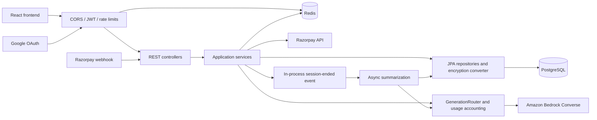

# Backend reference

Reviewed: 2026-10-21. Scope: backend source, SQL migrations, build/container configuration, tests, and selected frontend API callers. No production access or live AWS request was made. All paths below are relative to this document unless stated otherwise.

For the Docker Hub/ECS Fargate deployment proposal, future Cognito evaluation, Spring upgrades, and voice, see [future architecture](FUTURE_ARCHITECTURE.md). Bedrock routing and usage accounting now exist in the v2 chat workflow; production activation still requires AWS model access and reviewed model/policy settings.

The approved storage direction remains PostgreSQL; [memory design](MEMORY_DESIGN.md) specifies future confirmation, retrieval, provenance, and forget/reset behavior. Those features are not yet implemented; this document preserves the current-state snapshot.

For a focused comparison of the current schema with frontend/API behavior, see [schema review](SCHEMA_REVIEW.md), including onboarding payload mismatches and persona/completion semantics.

## 1. Architecture and boundaries

The backend is one Spring MVC application, not a set of microservices. It uses PostgreSQL for durable data and Redis for access-token revocation, chat rate limits, and short-lived admission leases. The accounted v2 generation path uses Amazon Bedrock. The old OpenAI-compatible adapter and API-key settings were removed. Legacy chat calls fail closed until clients migrate to v2. Google OAuth and Razorpay are separate external integrations.



Extraction jobs are stored in PostgreSQL and claimed with leases. There is no separate queue or vector database. Bedrock credentials use the AWS SDK default provider chain; deployment should use an ECS task role, not static access keys. Actuator exposes liveness/readiness and authenticated operational metrics. Redis is not a conversation or prompt cache.

| Area | Source | Responsibility |
| --- | --- | --- |
| Startup | [AiTherapyApplication](../src/main/java/com/hkv/AiTherapy/AiTherapyApplication.java) | Enables Spring Boot, scheduling, and async execution |
| HTTP | [controller](../src/main/java/com/hkv/AiTherapy/controller) | Auth, chat, profile/memory, payment, and development routes |
| Security | [SecurityConfig](../src/main/java/com/hkv/AiTherapy/config/SecurityConfig.java), [security](../src/main/java/com/hkv/AiTherapy/security) | JWT, Google OAuth, authorization, Redis rate limits |
| Application logic | [service](../src/main/java/com/hkv/AiTherapy/service) | Auth/token lifecycle, chat, profiles, memories, payments, deletion |
| AI integration | [service/ai](../src/main/java/com/hkv/AiTherapy/service/ai) | Gateway interface, HTTP implementation, prompt assembly |
| Background work | [service/job](../src/main/java/com/hkv/AiTherapy/service/job) | Summarization event listener and subscription expiry scheduler |
| Persistence | [domain](../src/main/java/com/hkv/AiTherapy/domain), [repository](../src/main/java/com/hkv/AiTherapy/repository) | Nine JPA entities/repositories, UUID identifiers |
| Encryption | [encryption](../src/main/java/com/hkv/AiTherapy/encryption) | Explicit JPA field conversion using AES-256-GCM |
| Contracts | [dto](../src/main/java/com/hkv/AiTherapy/dto) | HTTP request/response objects and AI payloads |
| Schema/config | [resources](../src/main/resources) | Flyway migrations V1–V4 and application configuration |
| Packaging | [pom.xml](../pom.xml), [Dockerfile](../Dockerfile) | Java 21, Boot 4.1.1, JJWT 0.13.0; Maven build and non-root JRE container |

## 2. Runtime flows

### Authentication

`AuthController → AuthService → UserRepository / TokenService / JwtTokenProvider`.

- Registration stores a BCrypt password hash and immediately issues tokens. Email verification is not implemented despite the `is_verified` field.
- Login checks the password and active flag. Access tokens are RS256 JWTs with user UUID subject, email, JTI, and expiry; default validity is 900 seconds.
- Refresh tokens are two UUID strings combined. PostgreSQL stores their SHA-256 hashes, device information, expiry, and revocation flag. Rotation locks the old row, rejects inactive accounts, and issues one new pair in the same transaction; default refresh validity is 30 days. Actual concurrent database behavior still needs a Docker-backed check.
- JWT authentication checks Redis key `jwt:denylist:<jti>` and requires an existing active user on every request. Missing Redis or database state fails closed. Security contexts are not stored in the OAuth session.
- Logout revokes the supplied refresh token and denylists a supplied valid access token for the full configured access-token lifetime. If Redis denylisting fails, refresh revocation is not committed; the API returns 503 so the client can retry.
- Google login requires a verified email and stable subject. By default it keeps the legacy redirect to `/oauth2/redirect?token=...` for the current frontend, without issuing a refresh token. With `OAUTH_TICKET_HANDOFF=true`, it redirects with a random, 60-second, single-use `ticket` instead. `POST /auth/oauth/exchange` consumes it atomically in Redis and issues an access and refresh pair. This opt-in contract is for the Phase F frontend. The callback and exchange responses request `no-store`; the redirect also requests `Referrer-Policy: no-referrer`.
- OAuth authorization state uses Redis-backed HTTP sessions with a five-minute lifetime, so a callback can reach a different service instance. Real Google and multi-instance round trips remain unverified. Redis loss fails the callback/exchange rather than minting tokens.

### Chat and prompts

`ChatController → ChatService → PromptBuilder / AIGateway / repositories`.

Legacy requests without a version header keep the existing ChatService/AIGateway behavior for the current frontend. Step 10 adds an isolated v2 path, activated per request with `X-Chat-Request-Version: 2` or `X-Chat-Stream-Version: 2`, and only when both `AI_CHAT_V2_ENABLED` and `AI_ROUTING_ENABLED` are true.

V2 session start, synchronous message submission, and streaming use durable user-scoped idempotency. A repeated active-session start reuses the session and does not generate another greeting. Chat turns are stored in `chat_turns`, linked to `ai_requests`, and retrievable through `GET /chat/requests/{requestId}`. User ownership, active state, and context eligibility are checked under row locks; a partial unique index permits only one active conversation per account. Session end is idempotent and sends a cancellation event after commit.

V2 reserves usage and persists the user turn in a short PostgreSQL transaction, then calls the resolved gateway after commit using a bounded executor. The stream sends named JSON `start`, `delta`, and terminal `complete`/`error` events. Assistant text is persisted only on success, and usage settlement commits with that message. Client disconnect, first-token/total deadline, and session end cancel the upstream token where possible. A late result cannot complete a terminal turn. If durable settlement fails, the stream closes without claiming success and the lease reconciler repairs the request and chat-turn status.

V2 assembles no more than 20 recent messages and ranks a bounded set of 50 eligible memories using topic overlap, follow-up due date, recency, and importance. It excludes pending, expired, stale-revision, and ineligible-source memories and includes only the latest context-valid session summary. Input reservation estimates use four characters per token until provider usage is available. These limits and the lightweight topic ranker are operational safeguards, not semantic-search guarantees.

The legacy session start still creates a new conversation and calls the old provider path; legacy normal-message and stream calls retain their prior transaction, error-marker, and cancellation limitations. Keep v2 disabled until Phase F/Step 13 validates the frontend and deployment settings.

[PromptBuilder](../src/main/java/com/hkv/AiTherapy/service/ai/PromptBuilder.java) uses the profile name, age, persona, style, topics, top five traits, and five most important unresolved memories. Missing profiles get a short fallback prompt. Due-follow-up and last-completed-session repository methods exist but are not used by this builder. There is no enforced prompt token budget.

The `GenerationRouter` selects model IDs from deployment policy and effective server-side entitlement. It sends generation to the Bedrock Converse adapter, with durable usage reservations and token settlement. The old `AIGateway` bean is now a fail-closed compatibility guard; it performs no network calls. `DisabledLegacyAIGateway` returns 503 for unversioned legacy chat. Clients must opt into the v2 chat and SSE headers until the frontend migration is complete.

### Summarization and scheduled work

[SummarizationJob](../src/main/java/com/hkv/AiTherapy/service/job/SummarizationJob.java) polls the PostgreSQL `extraction_jobs` table when both AI routing and the extraction worker are enabled. Session completion inserts a unique job in its transaction. Claims use `FOR UPDATE SKIP LOCKED` and a lease; expired claims recover automatically, transient failures use bounded exponential retry, and terminal failures can be explicitly replayed. The processor sends at most 200 recent messages and 24,000 transcript characters through the shared generation/accounting path. `SummaryExtractionValidator` checks output bounds, field/type/date rules, and that each profile/memory candidate cites a user message with a matching evidence quote.

Successful output is saved atomically with the job state after locking and rechecking the active account, completed eligible conversation, and current context revision. Summaries are revision-stamped; profile and memory outputs become pending candidates with source message, conversation, job, and deterministic output identity. Extraction does not overwrite confirmed profile values. Account deletion, conversation suppression, or profile reset makes stale jobs/results non-persistable. The worker defaults off, so enabling it requires the routed provider and usage dependencies to be configured first. The legacy mid-session refresh route remains a no-op for extraction.

[SubscriptionDowngradeJob](../src/main/java/com/hkv/AiTherapy/service/job/SubscriptionDowngradeJob.java) runs at midnight UTC under a PostgreSQL transaction-scoped advisory lock so only one replica performs the scheduled update. Extraction workers coordinate through row leases/`SKIP LOCKED`; usage reconciliation uses transactional row locks. Effective PRO entitlement separately checks `tier == PRO` and a future expiry, so expired access does not depend on the downgrade job running.

### Payments and deletion

[SubscriptionService](../src/main/java/com/hkv/AiTherapy/service/payment/SubscriptionService.java) creates a ₹50 INR Razorpay order for a server-owned purchase. Manual verification fetches the provider payment, then requires an exact captured amount/currency and matching order owned by the caller. A successful capture atomically records the payment, marks the purchase captured, and grants 30 PRO days. Renewal extends the later of now or the current unexpired PRO end. [EntitlementService](../src/main/java/com/hkv/AiTherapy/service/payment/EntitlementService.java) is the server-side effective-tier lookup used by chat and status; expired PRO is effective FREE before the downgrade scheduler runs. There is no recurring billing or refund processing.

Webhooks require HMAC-SHA256 over the raw body even in development mode; a missing secret returns 503 and an invalid signature returns 400. Only `payment.captured` triggers an upgrade. The handler resolves a server-owned purchase from the signed order ID and ignores untrusted `notes.userId`. The purchase row and user row are locked during capture, while unique payment/order IDs provide durable replay constraints. Real concurrent database delivery still needs a Docker-backed test. The old frontend's fixed shared Razorpay link does not create a purchase and its payment IDs are rejected; Phase F must use `POST /payment/purchases` and Razorpay Checkout with the returned order ID.

[AccountService](../src/main/java/com/hkv/AiTherapy/service/account/AccountService.java) locks the account row, then deletes messages, memories, traits, profile, conversations, refresh tokens, and user; SQL cascades also remove subscriptions/payments. It removes the rate-limit key. Outstanding access JWTs fail the per-request account existence check after deletion. Database deletion does not erase historical backups or provider-held data. Profile deletion removes profile, traits, and memories, leaving conversations and account intact; later summarization can recreate derived information.

## 3. HTTP contract

The Step 05 [OpenAPI draft](api/openapi.yaml), [contract decisions](api/README.md), and [streaming protocol](api/streaming.md) distinguish current routes from pending features. The implementation notes below remain a snapshot of current behavior.

Default server: `http://localhost:8080/api/v1`. Paths below are relative to `/api/v1`. Authenticated requests use `Authorization: Bearer <access-token>`. UUID ownership is checked in chat/memory services.

Most successful responses use `{success, data, error, timestamp}` from [ApiResponse](../src/main/java/com/hkv/AiTherapy/dto/response/ApiResponse.java). Error formatting is inconsistent: there is no global exception handler; filters, validation, and uncaught service exceptions can return different shapes/statuses. Do not promise a uniform error contract without integration tests.

| Method/path | Input | Success result / access |
| --- | --- | --- |
| POST `/auth/register` | `email`, `password` (min 8), optional `displayName` | 201, AuthResponse; public |
| POST `/auth/login` | `email`, `password` | 200, AuthResponse; public |
| POST `/auth/refresh` | `refreshToken` | 200, rotated AuthResponse; public |
| POST `/auth/logout` | `refreshToken`, optional bearer header | 200, message; public matcher |
| POST `/auth/oauth/exchange` | `ticket` | 200, AuthResponse; public; requires opt-in ticket callback |
| DELETE `/auth/account` | No body | 200, string; JWT required |
| POST `/chat/sessions` | No body; optional v2 request-version and idempotency headers | Legacy: 201; v2: 200 and active-session reuse; JWT |
| POST `/chat/sessions/{id}/messages` | Nonblank `content`; optional v2 request-version and idempotency headers | Legacy or idempotent v2 `ChatMessageResponse`; JWT |
| POST `/chat/sessions/{id}/stream` | Nonblank `content`; optional v2 stream-version and idempotency headers | Legacy raw SSE or v2 named SSE with request ID; JWT |
| GET `/chat/requests/{requestId}` | No body | Owner-scoped v2 generation state and stored answer; JWT |
| PUT `/chat/sessions/{id}/end` | No body | 200, null data; idempotent state transition; JWT |
| POST `/chat/sessions/{id}/refresh-profile` | No body | 200, null data after extraction; JWT |
| GET `/profile/me` | No body | 200, ProfileResponse; JWT; attempts lazy profile creation |
| PUT `/profile/me` | Optional `preferredName`, `ageRange`, `communicationStyle`, `aiPersona`, `topicsOfConcern` | 200, ProfileResponse; JWT |
| DELETE `/profile/me` | No body | 200, string; JWT |
| GET `/profile/me/memories` | `type`, `resolved`, `offset=0`, `limit=20` | 200, MemoryPageResponse; JWT |
| POST `/profile/me/memories` | `type`, `title`, optional `detail`, `importance` (1–10, default 5), `occurredAt`, `followUpAt` | 200, MemoryResponse; JWT |
| DELETE `/profile/me/memories/{id}` | No body | 204, no envelope; JWT |
| GET `/payment/status` | No body | 200, SubscriptionStatusResponse; JWT |
| POST `/payment/purchases` | No body | 201, `{purchaseId,orderId,keyId,amountPaise,currency}`; JWT |
| POST `/payment/verify` | Nonblank `paymentId` | 200, SubscriptionStatusResponse; JWT, not dev-gated |
| POST `/payment/webhook` | Raw JSON, `X-Razorpay-Signature` | Plain text `ok`; public with HMAC check |
| POST `/dev/force-pro` | No body | 200, SubscriptionStatusResponse; JWT and `DEV_MODE=true` required |
| POST `/dev/force-free` | No body | 200, SubscriptionStatusResponse; JWT and `DEV_MODE=true` required |

Google OAuth uses framework paths `/oauth2/authorization/google` and `/login/oauth2/code/google` under the context path. Check these with the deployed external host/proxy configuration.

Contract details for future changes:

- AuthResponse: `accessToken`, `refreshToken`, `expiresIn`, `user: {id,email}`.
- ConversationResponse: `id`, `status`, `tokenCount`, `startedAt`, `recentMessages`.
- ChatMessageResponse: `id`, `conversationId`, `senderRole`, `content`, `sentAt`.
- ProfileResponse: `userId`, the five editable profile fields above, `totalSessions`, `traits: [{key,confidence,source}]`.
- MemoryPageResponse: `memories`, `total`, `offset`, `limit`; MemoryResponse includes `id`, `type`, `title`, `detail`, `importance`, dates, and a boolean resolved property. Verify Jackson's actual boolean naming in contract tests before changing it.
- SubscriptionStatusResponse explicitly serializes `isPro`, alongside `tier` and `proExpiresAt`.
- There is no controller API for listing historical sessions, editing/resolving a memory, or managing traits directly.
- Profile updates ignore null fields; they do not implement clearing fields via null. V2 onboarding fields are not in the DTO/entity flow.
- Memory pagination computes `page = offset / limit`, so arbitrary offsets are rounded down to page boundaries; zero/negative/unbounded inputs are not guarded.
- Frontend [client.js](../../Frontend/src/api/client.js) already unwraps successful envelopes. [chat.js](../../Frontend/src/api/chat.js) has a double-unwrapping mismatch in `sendMessage`, and its fallback streaming URL omits `/api/v1`. Preserve/check all callers when revising the contract.

## 4. Persistent data and encryption

Source of schema truth: [Flyway migrations](../src/main/resources/db/migration). V1 creates the original seven tables; V2 adds onboarding columns; V3 widens age range to 50; V4 adds subscriptions/payments; V5 adds server-owned purchases. Hibernate uses `ddl-auto: validate`. Add new migrations rather than rewriting applied migration files.

| Table | Relationships and purpose | Application-encrypted columns |
| --- | --- | --- |
| `users` | Identity; unique email; OAuth fields; BCrypt hash; status flags | None |
| `therapy_profiles` | Unique user FK; preferences and session count | `preferred_name`, `topics_of_concern` |
| `personality_traits` | User FK; unique `(user_id,trait_key)` | `trait_value` |
| `conversations` | User FK; status, summary, timing, token estimate | `session_summary` |
| `messages` | Conversation FK; role, text, timestamp | `content` |
| `long_term_memories` | User FK; optional source conversation FK, ranking/dates | `title`, `detail` |
| `refresh_tokens` | User FK; unique SHA-256 token hash, expiry/revocation | None (token is hashed) |
| `user_subscriptions` | Unique user FK; FREE/PRO and expiry | None |
| `payments` | User FK; unique Razorpay payment ID; amount/currency/status | None |
| `purchases` | User FK; unique Razorpay order/payment IDs, expected amount/currency, capture state | None |

User-dependent FKs cascade on user deletion; messages cascade on conversation deletion; memory source FK uses `ON DELETE SET NULL`. Important indexes support user/conversation history, trait confidence, memory importance, and PRO expiry. No database constraint enforces a single active session per user.

Encryption is `Base64(12-byte IV || ciphertext || 16-byte GCM tag)` using one configured 32-byte key. The converter is opt-in, so identity metadata, trait keys, age, and payment records are not application-encrypted. V2's `enjoyments` SQL comment says encrypted, but no mapped entity/converter currently implements it. The memory title is declared TEXT in the entity while V1 creates `VARCHAR(500)`; encoded ciphertext expansion can exceed that database limit.

**Preserve the existing encryption master key when moving an existing database.** A newly generated key cannot decrypt old records. There is no key ID/version or rotation mechanism in the ciphertext format. RDS disk encryption or storing the key in Secrets Manager does not replace this application encryption. Prompt assembly decrypts data before sending it to the external AI provider.

## 5. Configuration and local operation

Source: [application.yaml](../src/main/resources/application.yaml). Spring receives environment variables; use [run-with-env.sh](../run-with-env.sh) for local `.env` loading and [compose.yaml](../compose.yaml) for disposable PostgreSQL/Redis services.

| Environment variables | Current meaning/default |
| --- | --- |
| `DATABASE_URL` | JDBC URL; default `jdbc:postgresql://localhost:5432/therapyai` (not a `postgres://` URL) |
| `DATABASE_USER`, `DATABASE_PASSWORD` | Default local user/password; replace for deployed environments |
| `REDIS_HOST`, `REDIS_PORT`, `REDIS_PASSWORD`, `REDIS_SSL` | localhost, 6379, empty password, false; timeout 2 seconds |
| `JWT_PRIVATE_KEY`, `JWT_PUBLIC_KEY` | Required for startup: base64 DER PKCS#8 private key and X.509 public key; parser strips whitespace, not PEM headers |
| `ENCRYPTION_MASTER_KEY` | Required for startup: base64 encoding of exactly 32 bytes |
| `GOOGLE_CLIENT_ID`, `GOOGLE_CLIENT_SECRET` | Empty by default; required by the `production` profile |
| `BEDROCK_REGION`, `AI_BEDROCK_ENABLED` | AWS region (user selected Mumbai `ap-south-1`) and explicit provider enable switch; off by default |
| `AI_ROUTING_ENABLED`, `AI_ROUTING_POLICY_ID`, `BEDROCK_FREE_MODEL_ID`, `BEDROCK_PRO_MODEL_ID`, `BEDROCK_SUMMARY_MODEL_ID` | Explicit server-side routing policy and model IDs; required before routing starts; not yet selected or live-tested |
| `AI_CHAT_V2_ENABLED`, `AI_EXTRACTION_WORKER_ENABLED` | Enable the accounted v2 chat path and durable extraction worker; both off by default |
| `CORS_ALLOWED_ORIGINS` | Comma-separated exact origins, default `http://localhost:5173`; first also determines OAuth frontend redirect |
| `RAZORPAY_KEY_ID`, `RAZORPAY_KEY_SECRET` | Used by manual payment fetch; empty defaults |
| `RAZORPAY_WEBHOOK_SECRET` | Required for signed webhook processing in every mode |
| `DEV_MODE` | Defaults false; `/dev/*` controllers are absent unless explicitly true. The `production` profile rejects dev mode and requires complete secrets, HTTPS CORS origins, and Bedrock/v2 features |

The AWS SDK uses its default credential chain. On ECS, attach a least-privilege task role for the selected Bedrock model(s); do not inject long-lived AWS keys. Readiness at `/api/v1/actuator/health/readiness` includes PostgreSQL and Redis; liveness excludes those dependencies. Bedrock is intentionally excluded from liveness/readiness so a short provider outage does not restart every task. `/actuator/metrics` requires authentication. Metrics include active/completed streams, extraction queue depth/transitions, settled token counts, and request outcomes with bounded purpose/tier/model/region labels. Dollar spend is not reported until the approved model, region, and pricing policy are fixed and verified.

Hikari allows 10 connections per instance (minimum idle 2). Redis contains `jwt:denylist:*` with a 900-second default TTL and `rl:chat:<userId>` with a one-minute TTL. The chat filter hardcodes 20 authenticated POST requests per minute across session creation, messaging/streaming, and profile refresh. Increment and expiry are separate operations. Redis failure prevents normal JWT authentication; it is an availability dependency, not an optional cache.

Several YAML settings are not wired into execution: `ai.provider.max-tokens`, `temperature`, and the `ai.limits` values do not control the hardcoded gateway/context/rate-limit behavior described above. Do not tune deployment capacity by changing those values alone.

Prerequisites: Java 21, PostgreSQL and Redis, keys injected securely into the process, and provider credentials for the features exercised. The exact currently deployed database/Redis versions are unknown. The historical plan's PostgreSQL 15+/Redis 7+ targets are not evidence of live versions.

From the repository root, after provisioning local dependencies and environment:

```bash
cd Backend
./mvnw test
./mvnw spring-boot:run
```

If the wrapper lacks execute permission, use `sh mvnw`. On Windows use `mvnw.cmd`. First use requires Maven/dependency downloads. For a container build from the repository root:

```bash
docker build -t aitherapy-backend:local Backend
```

The Dockerfile skips tests, copies only `pom.xml` and `src` into its build stage, and runs the resulting JAR as a non-root user on 8080. Run tests separately before release. Supply runtime variables securely and ensure the database/Redis hostnames are reachable from inside the container. `/api/v1/actuator/health/liveness` is the dependency-free liveness probe; `/api/v1/actuator/health/readiness` checks PostgreSQL and Redis. Health responses hide component details; `/actuator/metrics` requires authentication.

## 6. Findings to address before major deployment changes

These are source-level findings, not claims from a penetration test. Priorities indicate suggested implementation order.

| Priority | Finding and evidence | Required outcome |
| --- | --- | --- |
| P0 (Step 01 addressed) | [DevController](../src/main/java/com/hkv/AiTherapy/controller/DevController.java) previously always registered free PRO upgrades | Controller now requires `DEV_MODE=true`; normal-mode HTTP test passes |
| P0 (partly addressed) | [OAuth2SuccessHandler](../src/main/java/com/hkv/AiTherapy/security/OAuth2SuccessHandler.java) previously logged JWTs and still sends them in URLs | Token logging and the unused token-bearing source file were removed; URL handoff and Git history cleanup remain |
| P0 | [SubscriptionService](../src/main/java/com/hkv/AiTherapy/service/payment/SubscriptionService.java) does not bind manual verification to a server-owned user/order or enforce INR | Verify ownership, currency, amount, and replay/concurrency behavior before accepting payment-derived entitlement |
| P1 (Step 01 addressed) | [SecurityConfig](../src/main/java/com/hkv/AiTherapy/config/SecurityConfig.java) previously permitted all `/auth/**`, including account deletion | Only the specified public auth endpoints remain public; deletion requires a JWT |
| P1 (Step 11 addressed) | Summarization used to race commit, lose events on restart, and mark failed extraction complete | PostgreSQL job table, leases/retries/replay, evidence validation, and atomic terminal persistence are implemented |
| P1 (partly addressed in v2) | Legacy session start/message operations retain weaker concurrency semantics | Preserve legacy contract during rollout; migrate frontend to tested v2 before disabling the legacy route |
| P1 (partly addressed in v2) | Legacy stream persistence/cancellation is incomplete; remote calls can hold DB transactions | Keep legacy isolated; complete the v2 Postgres/Redis and HTTP stream gates before enabling it |
| P1 (Step 12 addressed) | No health checks/metrics; unbounded SimpleAsyncTaskExecutor | Actuator readiness/liveness and operational metrics are enabled; chat work uses a bounded pool; legacy external AI adapter/configuration removed |
| P1 | OAuth state across replicas and JWT continuity have no deployment tests | Test redirects, token refresh, logout, restart, and multi-instance behavior |
| P2 | Profile GET creates data inside a read-only transaction; V2 fields unused; memory title schema mismatch | Add real database coverage and reconcile intended schema/API behavior |
| P2 | Chat size, memory pagination, and profile length limits incomplete; errors inconsistent | Validate boundaries and implement a tested error contract |
| P2 | Concurrent refresh/payment processing and Redis TTL assignment are not atomic end-to-end | Add locking/atomic operations and duplicate-request tests |

Current tests include [SecurityHttpTest](../src/test/java/com/hkv/AiTherapy/security/SecurityHttpTest.java), chat-turn lifecycle Testcontainers checks, token-log capture, ownership unit tests, encryption/JSON characterization, and chat/summarization tests. PostgreSQL/Redis Testcontainers checks skip when Docker is absent; Step 10's new migration and chat workflow integration tests require the GitHub Actions run to execute them. A real browser rollout remains a later Phase F gate.

The [keep-alive workflow](../../.github/workflows/keep-alive.yml) targets Render. This is evidence of deployment intent, not confirmation of the live host or its current configuration. Inventory the actual deployment before moving data.
